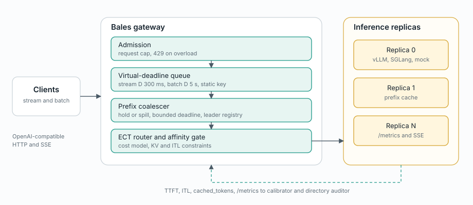

# Bales

<p align="center">
  <a href="https://github.com/ab1nv/bales">
    
  </a>
</p>

<p align="center">
  <strong>A cost-aware gateway prototype for mixed LLM traffic.</strong>
</p>

Bales sits in front of OpenAI-compatible inference replicas. It hashes prompts
into tenant-salted blocks, keeps a per-replica belief about cached prefixes,
values hits with a calibrated prefill cost model, and coalesces same-prompt
requests that arrive while a leader is still prefilling. Stream and batch
requests share the cluster through a virtual-deadline admission queue.

The `proto` branch is the second-generation Go rewrite. The `main` branch holds
an earlier CPU inference gateway that shares the name and logo.

## Status

- Go 1.27, standard library only.
- Unit tests, race tests, and the claims validator pass.
- A local demo runs the gateway against two mock OpenAI-compatible workers.
- Cluster results are simulated. No GPU experiments have been run.
- Routing baselines are simplified ports and have not received a full tuning
  budget.

## Architecture

<p align="center">
  
</p>

The gateway accepts a request within its admission cap, assigns a static virtual
deadline, and pops it in deadline order. The coalescer either holds the request until an in-flight leader
finishes prefill or spills it to the best alternative replica. The ECT router
scores each replica in milliseconds using the calibrated cost model, queue work,
KV capacity, and an ITL guard. Telemetry closes the loop: engine-reported cached
tokens audit the directory belief, and prefill timings refine the cost model.

## Quick start

```sh
make build
./bin/bales-mockworker -addr 127.0.0.1:9001 -id mock-1 &
./bin/bales-mockworker -addr 127.0.0.1:9002 -id mock-2 &
./bin/bales-gateway \
  -replicas http://127.0.0.1:9001,http://127.0.0.1:9002 \
  -telemetry evidence/runs/gateway.csv
```

Send a streaming request:

```sh
curl -N http://127.0.0.1:8080/v1/chat/completions \
  -H 'Content-Type: application/json' \
  -d '{"model":"mock","stream":true,"max_tokens":16,
       "messages":[{"role":"user","content":"Explain prefix caching briefly."}]}'
```

`make demo` starts both workers and the gateway, sends four staggered copies of
one prompt, then prints `/debug/stats` and the telemetry rows.

Useful endpoints: `GET /healthz`, `GET /metrics`, `GET /debug/stats`.

## Tests

```sh
make ci          # go vet, go test, evidence ledger check
make race        # go test -race ./...
```

The gateway test suite includes a two-request coalescing test over a real HTTP
proxy, a queue wait-bound fuzz test with 200 randomized trials, and concurrent
registry tests.

## Benchmarks

### Microbenchmarks

Measured on an Apple M5 host, not on a GPU. Run `make bench` to reproduce.

| Benchmark                    | Result                          |
| ---------------------------- | ------------------------------- |
| Coalescing decision          | 15.9 ns/op, 0 allocs            |
| ECT replica pick, 8 replicas | 33.9 ns/op, 0 allocs            |
| Queue push and pop           | 37.7 ns/op                      |
| Chained block hashing        | 1.08 GB/s, about 0.95 us per KB |

### Simulated scenarios

Generated with `make sim`, which runs `cmd/simulate` and writes
`evidence/runs/`. Values below use three seeds and four replicas.

| Scenario                                   | Policy           | Result                                                           |
| ------------------------------------------ | ---------------- | ---------------------------------------------------------------- |
| Cold burst, 32 requests, 2048-token prompt | round robin      | P50 TTFT 504.6 ms, prefill work 3886.6 ms, duplicate ratio 0.969 |
| Cold burst, same trace                     | ECT + coalescing | P50 TTFT 142.5 ms, prefill work 509.4 ms, duplicate ratio 0.667  |
| Long context, 8k-token prefixes, 6 req/s   | least tokens     | P99 TTFT 3036 ms                                                 |
| Long context, same trace                   | ECT              | P99 TTFT 1209 ms                                                 |
| Mixed queue, 8 req/s                       | FIFO             | stream P99 5025 ms, batch P99 wait 4649 ms                       |
| Mixed queue, 8 req/s                       | strict priority  | stream P99 562 ms, batch P99 wait 5109 ms                        |

The burst result is the clearest signal in the prototype: coalescing cuts
prefill work by about 87 percent and request P50 TTFT by about 72 percent
against the simulated round-robin baseline. The long-context gap comes mostly
from queue-aware routing rather than the quadratic term. Strict priority protects streams and penalizes batch work, as expected. EDF with the default 5 s batch deadline behaves like strict priority; an
0.8 s batch deadline lowers batch wait but raises stream P99 to 4662 ms.

These are not production numbers. The simulator processes one prefill at a time
per replica, does not batch decode, and gives every policy the same speculative
directory. Treat the results as directional and reproducible, not as a
comparison against tuned llm-d or Dynamo deployments. `evidence/claims.csv`
lists every number with its run file.

## Goals

- Measure duplicate prefill for cold same-prompt bursts and test whether
  gateway-level coalescing removes it without hurting request latency.
- Calibrate a prefill cost model per deployment and use it to value cached
  prefixes in routing and hold-or-spill decisions.
- Bound queue waits under admission control, then compare virtual deadlines
  with strict priority and weighted fair queueing.
- Choose spread, pin, or replicate per prefix group from recoverable work.
- Validate simulator fidelity against real T4 runs before making large-cluster
  claims.

The current evidence supports the coalescing mechanism in simulation. It does
not yet support a claim that the quadratic cost term or EDF improves results on
its own. Those questions need the GPU calibration and baseline tuning described
in `reports/REPORT.pdf`.

## Layout

```text
cmd/            gateway, mock worker, simulator, calibration CLI
internal/
  cost/         prefill model, NNLS fit, online calibration
  prefix/       tenant-salted hashing, cache belief, auditor
  queue/        virtual-deadline admission queue
  coalesce/     leader registry and hold-or-spill rule
  sched/        routing policies and affinity gate
  engine/       OpenAI-compatible streaming adapter
  gateway/      HTTP server and request path
  sim/          trace-driven cluster and queue simulators
  telemetry/    24-column request CSV contract
evidence/       claims ledger, manifests, raw runs, figures
reports/        REPORT.pdf and its source
presentation/   interactive HTML deck
archive/        STUDY.pdf
```

## Limitations

- No GPU or T4 measurements yet. The simulator is the only cluster evidence.
- Coalescing matches exact full-prompt chains. Nested prefix groups need the
  trie that the design describes.
- The default tenant salt must be changed before any shared deployment.
- The gateway records cache beliefs at routing time. The auditor reports the
  mismatch against engine `cached_tokens`, but a precise KV-event mode is not
  implemented.
- The public traces named in the plan are not bundled. The checked-in experiments
  use synthetic traces from `internal/sim/trace.go`.

## Documents

- `reports/REPORT.pdf`: project report
- `presentation/index.html`: 15-slide interactive deck, open it in a browser
- `archive/STUDY.pdf`: plain-language study guide and speaking notes
- `evidence/README.md`: how the claims and runs were produced

## License

MIT. See `LICENSE`.
